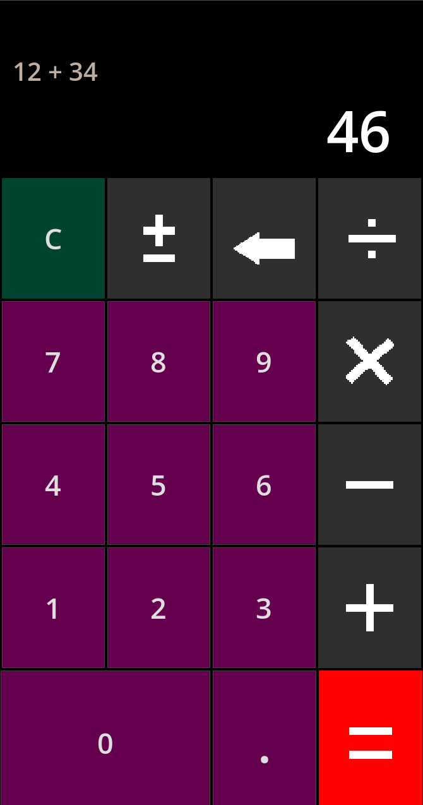

# GT Kalcul

Une calculatrice mobile simple et lisible, réalisée avec **Godot 4** et **GDScript**.

Le projet gère les quatre opérations de base, les nombres décimaux, le changement de signe et l'effacement du dernier chiffre. L'interface est pensée pour un écran de téléphone en mode portrait.



---

## Fonctionnalités

- Addition, soustraction, multiplication et division
- Nombres décimaux avec une seule virgule par nombre
- Changement de signe `+/-`
- Effacement du dernier chiffre saisi
- Bouton `C` pour tout réinitialiser
- Gestion de la division par zéro
- Arrondi des résultats pour éviter `0.30000000000000004`
- Blocage des zéros inutiles (`05`, `-05`)
- Interface adaptée au mobile en portrait

---

## Télécharger une version compilée

Les versions compilées sont prévues pour être publiées dans la section **Releases** du dépôt GitHub.

| Plateforme | Fichier | remarque |
|---|---|---|
| Linux x86_64 | `GT-Kalcul-Linux-x86_64.zip` | Décompresser puis lancer `GT-Kalcul.x86_64` |
| Android | `GT-Kalcul-Android-debug.apk` | APK de debug, installable directement sur un téléphone |

Les fichiers compilés générés localement se trouvent dans le dossier `builds/` (non versionné par Git). Pour les rendre disponibles sur GitHub, il faut les joindre à une Release (voir la section [Publier sur GitHub](#publier-sur-github)).

---

## Lancer le projet

### Prérequis

- [Godot 4](https://godotengine.org/download) (version 4.3 ou plus récente ; testé avec Godot 4.7.2)
- Les templates d'export sont nécessaires uniquement pour compiler une version

### Avec l'éditeur

1. Ouvrir Godot.
2. Cliquer sur **Importer** et choisir le fichier `project.godot`.
3. Ouvrir le projet.
4. Appuyer sur **F5** (ou cliquer sur **Jouer**).

La scène principale est `assets/calculatrice.tscn`.

### En ligne de commande

```bash
godot --path .
```

> Selon ton installation, la commande peut être `godot4`, `godot-mono` ou le chemin complet vers l'exécutable Godot.

---

## Comment fonctionne le projet

### Structure des fichiers

```text
gt-kalcul/
├── assets/
│   ├── calculatrice.gd          # Toute la logique de la calculatrice
│   ├── calculatrice.tscn        # La scène principale (interface)
│   ├── effacer.png              # Icône "effacer"
│   ├── operateur-1.png          # Icône "="
│   ├── operateur-2.png          # Icône "+"
│   ├── operateur-3.png          # Icône "−"
│   ├── operateur-4.png          # Icône "÷"
│   ├── operateur-5.png          # Icône "+/-"
│   ├── operateur-6.png          # Icône "×" (non utilisée)
│   └── operateur( suite)-1.png  # Icône "×" utilisée
├── docs/
│   └── screenshot.png           # Image affichée dans ce README
├── builds/                      # Versions compilées (ignoré par Git)
├── project.godot                # Configuration Godot
├── export_presets.cfg           # Réglages d'export Linux / Android
└── README.md
```

### La scène

```text
calculatrice (Control)
└── Panel
    └── ColorRect
        └── VBoxContainer
            ├── Affichage
            │   └── MarginContainer
            │       └── VBoxContainer
            │           ├── Operation  (%Operation)
            │           └── Resultat   (%Resultat)
            └── Boutons  (%Boutons)
                ├── GridContainer
                │   └── boutons 0 à 9, opérateurs et actions
                └── HBoxContainer
                    └── boutons 0, . et =
```

- `%Operation` affiche le calcul en cours (par exemple `12 +`).
- `%Resultat` affiche le nombre en cours ou le résultat.
- `%Boutons` sert à connecter automatiquement les boutons des chiffres.

### Les boutons

Les boutons importants portent des noms explicites :

| Nœud | Rôle |
|---|---|
| `btn_clear` | Tout effacer |
| `btn_signe` | Changer le signe (`+/-`) |
| `btn_effacer` | Effacer le dernier chiffre |
| `btn_diviser` | Division |
| `btn_multiplier` | Multiplication |
| `btn_soustraire` | Soustraction |
| `btn_additionner` | Addition |
| `btn_virgule` | Virgule décimale |
| `btn_egal` | Calculer le résultat |

Les boutons `0` à `9` sont nommés simplement `"0"`, `"1"`, ... `"9"`.

Les signaux des boutons spéciaux sont connectés directement dans la scène. Les boutons des chiffres sont connectés dans `_ready()` :

```gdscript
func _ready() -> void:
    for groupe in %Boutons.get_children():
        for bouton in groupe.get_children():
            if str(bouton.name).is_valid_int():
                bouton.pressed.connect(_on_chiffre_pressed.bind(str(bouton.name)))
```

Cela évite d'écrire dix fonctions presque identiques.

### Les variables d'état

| Variable | Rôle |
|---|---|
| `nombre1` | Premier nombre de l'opération |
| `nombre2` | Deuxième nombre de l'opération |
| `operateur` | Opérateur choisi (`+`, `-`, `x`, `/`) |
| `saisie_en_cours` | `true` quand l'utilisateur est en train de taper un nombre |
| `partie_decimale` | `true` si le nombre en cours contient déjà une virgule |
| `PRECISION` | Précision utilisée pour arrondir les résultats |

### Les fonctions principales

| Fonction | Rôle |
|---|---|
| `_on_chiffre_pressed()` | Ajoute un chiffre au nombre en cours |
| `_on_virgule_pressed()` | Ajoute une virgule (une seule par nombre) |
| `_on_additionner_pressed()` | Lance une addition |
| `_on_soustraire_pressed()` | Lance une soustraction |
| `_on_multiplier_pressed()` | Lance une multiplication |
| `_on_diviser_pressed()` | Lance une division |
| `_choisir_operateur()` | Enregistre le premier nombre et l'opérateur |
| `_on_egal_pressed()` | Calcule et affiche le résultat |
| `_on_clear_pressed()` | Réinitialise toute la calculatrice |
| `_on_signe_pressed()` | Inverse le signe du nombre affiché |
| `_on_effacer_pressed()` | Supprime le dernier chiffre |
| `_format_nombre()` | Arrondit et nettoie le texte affiché |

### Exemple de calcul : `12 + 34 = 46`

1. L'utilisateur tape `1`, puis `2` : `_on_chiffre_pressed()` construit `"12"`.
2. Il appuie sur `+` : `_choisir_operateur("+")` enregistre `nombre1 = 12` et affiche `12 +`.
3. Il tape `3`, puis `4` : le résultat affiché devient `"34"`.
4. Il appuie sur `=` : `_on_egal_pressed()` convertit l'affichage en `nombre2 = 34`, calcule `12 + 34`, affiche `46` et remet `operateur` à vide.

---

## Compiler le projet

### Installer les templates d'export

Dans Godot : **Éditeur → Gérer les templates d'export**, puis télécharger les templates correspondant à la version de Godot utilisée.

### Linux

```bash
mkdir -p builds/linux
godot --headless --path . \
  --export-release "Linux" builds/linux/GT-Kalcul.x86_64
```

Cela produit :

- `builds/linux/GT-Kalcul.x86_64` : l'exécutable
- `builds/linux/GT-Kalcul.pck` : les ressources du jeu

Le fichier `.pck` doit rester à côté de l'exécutable.

Pour créer l'archive de distribution :

```bash
cd builds/linux
zip ../GT-Kalcul-Linux-x86_64.zip GT-Kalcul.x86_64 GT-Kalcul.pck LISEZMOI.txt
```

### Android

L'export Android nécessite :

- le SDK Android ;
- un JDK 17 ;
- un keystore de debug configuré dans les réglages de l'éditeur Godot ;
- le chemin du SDK Android configuré dans **Éditeur → Paramètres de l'éditeur → Export Android**.

Commande utilisée pour l'APK de debug :

```bash
mkdir -p builds/android
godot --headless --path . \
  --export-debug "Android" builds/android/GT-Kalcul-Android-debug.apk
```

Pour une version de release destinée au Play Store, il faut configurer un keystore de release dans **Projet → Exporter → Android**, puis utiliser :

```bash
godot --headless --path . \
  --export-release "Android" builds/android/GT-Kalcul-Android-release.apk
```

Le nom de paquet configuré est `com.RNS.kalcule`.

### Versions déjà générées

Les fichiers suivants ont été générés :

```text
builds/
├── GT-Kalcul-Linux-x86_64.zip
├── GT-Kalcul-Android-debug.apk
└── SHA256SUMS.txt
```

Vérifications effectuées : le binaire Linux démarre sans erreur et la signature de l'APK Android est valide.

Vérifier les sommes de contrôle :

```bash
sha256sum -c SHA256SUMS.txt
```

---

## Publier sur GitHub

### 1. Initialiser le dépôt

```bash
git init
git add .
git commit -m "Première version de GT Kalcul"
git branch -M main
git remote add origin https://github.com/UTILISATEUR/gt-kalcul.git
git push -u origin main
```

Remplace `UTILISATEUR` par ton nom d'utilisateur GitHub.

### 2. Créer une Release avec les versions compilées

Le dossier `builds/` est ignoré par Git : les binaires ne sont pas envoyés dans le dépôt. C'est volontaire, car un exécutable de 70 Mo et un APK de 29 Mo alourdissent inutilement l'historique Git.

Il faut donc les joindre à une **Release** GitHub :

```bash
git tag v1.0.0
git push origin v1.0.0

gh release create v1.0.0 \
  builds/GT-Kalcul-Linux-x86_64.zip \
  builds/GT-Kalcul-Android-debug.apk \
  --title "GT Kalcul v1.0.0" \
  --notes "Première version de GT Kalcul."
```

Il est aussi possible de le faire depuis l'interface web : **Releases → Draft a new release**, puis glisser les fichiers dans la zone des assets.

---

## Limites actuelles

- Une seule opération à la fois : il faut appuyer sur `=` avant d'enchaîner une nouvelle opération, sinon le calcul précédent est remplacé.
- Pas de priorité des opérateurs (`2 + 3 × 4` n'est pas évalué comme sur une calculatrice scientifique).
- Pas de pourcentage, de mémoire, ni d'historique.
- Le séparateur décimal affiché est `.` et non `,`.
- Pas de support du clavier physique.
- L'APK fourni est une version de **debug**, pas une version signée pour le Play Store.

## Pistes d'amélioration

- Ajouter le support du clavier
- Ajouter le pourcentage et la mémoire
- Gérer les opérations enchaînées avec priorités
- Ajouter des tests automatisés au projet
- Créer un workflow GitHub Actions pour compiler automatiquement les versions

---

## Licence

Aucune licence n'est définie pour le moment. Si tu souhaites autoriser la réutilisation du code, ajoute un fichier `LICENSE` (MIT, GPL, etc.) avant de publier le dépôt.
